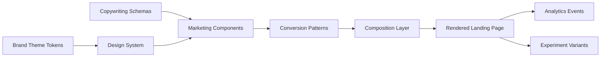

# Architecture

> System architecture for the Landing Marketing Kit — a domain-agnostic, composable foundation for SaaS landing pages.

## High-Level Architecture

```
┌─────────────────────────────────────────────────────────────────┐
│                        SAAS PRODUCT                             │
│  (Business logic, data, auth, billing — NOT part of this kit)  │
└────────────────────────────────┬────────────────────────────────┘
                                 │ consumes
                                 ▼
┌─────────────────────────────────────────────────────────────────┐
│                  LANDING MARKETING KIT                          │
│  ┌─────────────────┐  ┌─────────────────┐  ┌─────────────────┐  │
│  │  Design System  │  │ Marketing       │  │ Conversion      │  │
│  │  (Tokens, UI    │  │  Components     │  │  Patterns       │  │
│  │   Primitives)   │  │  (Atomic/       │  │  (Molecular/    │  │
│  │                 │  │   Molecular)    │  │   Organism)     │  │
│  └────────┬────────┘  └────────┬────────┘  └────────┬────────┘  │
│           │                    │                    │            │
│           ▼                    ▼                    ▼            │
│  ┌─────────────────────────────────────────────────────────┐    │
│  │              COMPOSITION LAYER                          │    │
│  │  Pages • Sections • Templates • Themes • Copy Schemas   │    │
│  └────────────────────────────┬────────────────────────────┘    │
│                               │                                 │
│           ┌───────────────────┼───────────────────┐             │
│           ▼                   ▼                   ▼             │
│  ┌───────────────┐  ┌───────────────┐  ┌───────────────┐       │
│  │   Analytics   │  │  Experiment-  │  │   Copywriting │       │
│  │   & Events    │  │  ation (A/B)  │  │   System      │       │
│  └───────────────┘  └───────────────┘  └───────────────┘       │
└─────────────────────────────────────────────────────────────────┘
```

## Layer Definitions

### 1. Design System (`packages/design-tokens`, `packages/ui-core`)

**Responsibility**: Pure visual language — no business logic, no marketing semantics.

| Sub-layer | Contents |
|-----------|----------|
| **Tokens** | Color, spacing, typography, radius, shadows, motion, breakpoints, z-index — defined as platform-agnostic JSON + TypeScript types |
| **Primitives** | Box, Flex, Grid, Text, Heading, Button, Input, Card, Badge, Avatar, Separator, Tooltip, Dialog, Dropdown, Tabs, Accordion — built on shadcn/ui + Radix/UI |
| **Theme System** | CSS variable–based theming; brand tokens override base tokens; multiple themes loadable at runtime |

**Key Constraint**: Zero dependencies on marketing concepts (no "Hero", "CTA", "Testimonial" here).

### 2. Marketing Components (`packages/marketing-components`)

**Responsibility**: Semantic marketing primitives — composable, accessible, theme-aware.

| Category | Components |
|----------|------------|
| **Navigation** | Navbar, MobileNav, Breadcrumbs, SkipLink |
| **Hero** | HeroClassic, HeroProduct, HeroSplit, HeroVideo, HeroDashboard, HeroMinimal |
| **Conversion** | CTAButton, CTABanner, CTAFinal, CTASticky |
| **Trust** | LogoCloud, TestimonialCard, TestimonialCarousel, ReviewCard, CaseStudyCard, TrustBadges, TrustBar |
| **Product** | FeatureCard, FeatureGrid, ProductShowcase, WorkflowStep, IntegrationLogo, ComparisonTable |
| **Pricing** | PricingCard, PricingTable, PricingToggle, PricingFAQ |
| **Content** | FAQAccordion, StatsBar, BenefitList, UseCaseCard, IconList |
| **Footer** | FooterClassic, FooterSaaS, FooterMultiColumn, NewsletterSignup |

**Key Constraint**: Components accept **structured content props** (typed schemas), not raw strings. Content is injected from the Copywriting layer.

### 3. Conversion Patterns (`packages/conversion-patterns`)

**Responsibility**: Opinionated, tested section compositions — "organisms" that implement conversion frameworks.

| Pattern | Use Case |
|---------|----------|
| `ProblemSolutionPattern` | Pain-point → solution narrative |
| `SocialProofPattern` | Testimonials + logos + stats |
| `FeatureValuePattern` | Feature → benefit → proof mapping |
| `ObjectionHandlingPattern` | FAQ + risk reversal + guarantee |
| `PricingDecisionPattern` | Plan comparison + FAQ + CTA |
| `FooterConversionPattern` | Final CTA + newsletter + links |

**Key Constraint**: Patterns are **configurable via schema** — not hardcoded layouts. A pattern defines *slots*; the product fills them.

### 4. Composition Layer (`apps/templates`, `apps/playground`)

**Responsibility**: Assembles patterns into complete pages; provides starter templates per SaaS type.

| Template Type | Target |
|---------------|--------|
| `saas-b2b` | Long-form, proof-heavy, multi-stakeholder |
| `saas-b2c` | Emotional, benefit-led, quick decision |
| `ai-saas` | Demo-forward, capability-focused, trust-critical |
| `pro-tool` | Feature-dense, workflow-oriented, technical |
| `marketplace` | Two-sided, liquidity signals, trust badges |
| `premium` | Minimal, brand-led, scarcity/authenticity |
| `simple` | Single-value-prop, low friction, fast signup |
| `complex` | Modular, navigable, progressive disclosure |

### 5. Cross-Cutting Concerns

| Concern | Package | Description |
|---------|---------|-------------|
| **Analytics** | `packages/analytics` | Event taxonomy (命名规范), auto-tracking hooks, consent management |
| **Experimentation** | `packages/experimentation` | A/B test wrapper, variant assignment, server/client sync |
| **Copywriting** | `packages/copywriting` | Content schemas (Zod), variant management, localization-ready |
| **SEO** | `packages/seo` | Metadata helpers, JSON-LD generators, sitemap utilities |
| **Performance** | `packages/performance` | Image optimization, font loading, critical CSS, bundle analysis |

## Data Flow: Content → Page



**Content Injection Points**:
1. **Theme tokens** → CSS variables (build-time or runtime)
2. **Copy schemas** → Component props (validated at compile time via Zod)
3. **Pattern configs** → Pattern composition (validated at compile time)
4. **Page config** → Template assembly (validated at compile time)

## Type Safety Strategy

- **Design tokens**: TypeScript `const` assertions + JSON Schema validation
- **Component props**: Zod schemas → inferred TypeScript types
- **Pattern configs**: Zod discriminated unions per pattern type
- **Page configs**: Zod schema per template type
- **Analytics events**: Branded string literals + payload schemas

## Theming Architecture

```
Base Tokens (design-tokens/base)
       │
       ├── brand/primary, brand/secondary, brand/accent
       ├── semantic/success, semantic/warning, semantic/error
       ├── surface/background, surface/foreground, surface/muted
       └── ...
              │
              ▼
Brand Theme Override (themes/{brand-name})
       │
       ├── Overrides only brand-relevant tokens
       ├── Preserves semantic token structure
       └── Outputs CSS variables + TS types
              │
              ▼
Runtime: CSS variables injected via <ThemeProvider>
Build-time: Types generated for component consumption
```

## Package Dependency Graph

```
design-tokens (no deps)
       ▲
       │
ui-core ◄──────────────────────┐
       │                       │
       ▼                       │
marketing-components ◄────────┤ (consumes tokens + primitives)
       │                       │
       ▼                       │
conversion-patterns ◄─────────┤ (consumes components)
       │                       │
       ▼                       │
composition (templates) ──────┘
       │
       ▼
analytics / experimentation / copywriting / seo / performance
       │ (peer dependencies, consumed by components/patterns)
       ▼
apps/docs, apps/playground, apps/templates
```

## Build & Distribution

| Artifact | Format | Consumers |
|----------|--------|-----------|
| Design tokens | JSON + `.d.ts` | All packages, external tools (Figma, Style Dictionary) |
| UI primitives | ESM + types | marketing-components, external apps |
| Marketing components | ESM + types | conversion-patterns, templates |
| Conversion patterns | ESM + types | templates, apps |
| Copywriting schemas | Zod + TS types | components, patterns, CMS integration |
| Analytics events | TS types + runtime validators | components, patterns, tracking setup |

**Publishing**: Private npm registry (or GitHub Packages) with `changesets` for versioning.

## Runtime Requirements

- **React 19+** (RSC compatible)
- **Next.js 15+** (App Router, Server Actions)
- **Tailwind CSS v4** (CSS-first, OKLCH colors)
- **Node 20+** (for build tooling)

## Non-Goals (Explicitly Out of Scope)

- ❌ Backend / API / Database logic
- ❌ Authentication / User management
- ❌ Billing / Subscription logic
- ❌ Email / Notification systems
- ❌ CMS / Content management (but provides schemas for CMS integration)
- ❌ Specific product copy or imagery
- ❌ Deployment infrastructure

## Architectural Decisions Log

See [DECISIONS.md](DECISIONS.md) for detailed decision records with rationale, alternatives considered, and approval status.

---

*Next: [Principles](PRINCIPLES.md) — Core design & development principles*